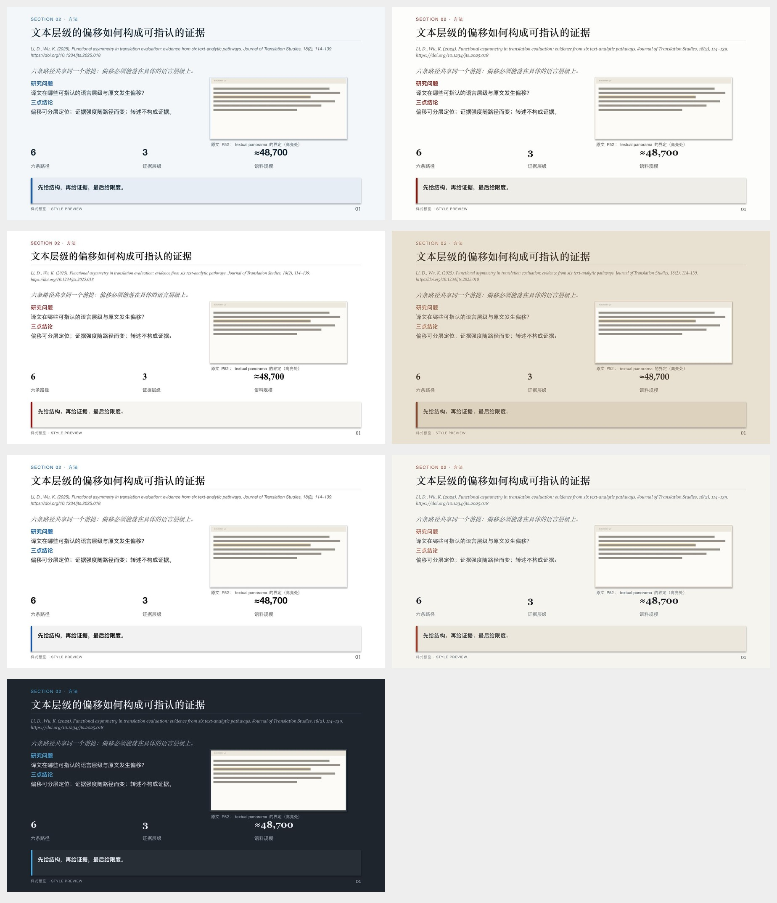

# build-academic-ppt

Build an academic presentation deck in which **every claim is traceable to a
highlighted passage in the actual source document**. The screenshots are
evidence, not decoration.

Designed for Claude Code, and usable from any agent that can run Python.

---

## What it does

- **Asks before it builds.** A mandatory intake brief: the topic, the key
  points, the research question, the sources, the visual style, the length.
  Two rounds of questions; after that it derives the rest from the sources
  and lists every assumption.
- **Seven visual styles**, each a complete system — surfaces, two accents,
  type pairing, type scale — not a colour swap. All contrast-audited to
  WCAG AA, all rendered as previews.
- **Crops that carry their evidence.** A phrase that appears three times no
  longer resolves silently to the first occurrence; a crop whose highlight
  would fall outside the frame is refused rather than produced.
- **A mechanical gate that sees what it used to miss**: text printed on top of
  a screenshot, text escaping its own frame, crops with no highlight, slides
  missing a citation, type below the floor.
- **Two modes**: build a new deck, or edit one the human has already
  hand-edited — in which case their file is the only valid baseline.

## The seven styles



| key | name | reads as |
|---|---|---|
| `paper-warm` | 暖纸朱砂 / Warm Paper & Cinnabar | a printed monograph |
| `minimal-white` | 极简白 / Minimal White | content-only, maximum whitespace |
| `journal-serif` | 学术期刊 / Journal Serif | a journal article that happens to be slides |
| `slate-dark` | 冷灰深色 / Slate Dark | a talk in a bright room |
| `blueprint` | 蓝图理性 / Blueprint | a technical document |
| `kraft` | 牛皮纸 / Kraft Vellum | archival, bookish |
| `ink-wash` | 水墨留白 / Ink Wash | close reading, quiet |

Regenerate the previews after editing a palette:

```bash
python3 skills/build-academic-ppt/scripts/style_previews.py --sheets
```

## Install

### As a Claude Code plugin

```
/plugin install build-academic-ppt --marketplace JFWaskin/build-academic-ppt
```

or, to add the marketplace first and install from it:

```
/plugin marketplace add JFWaskin/build-academic-ppt
/plugin install build-academic-ppt
```

### As a plain skill directory

```bash
git clone https://github.com/JFWaskin/build-academic-ppt.git
cp -R build-academic-ppt/skills/build-academic-ppt ~/.claude/skills/
```

or

```bash
./install.sh          # copies the skill and checks the dependencies
```

### Requirements

| tool | needed for | install |
|---|---|---|
| Python 3.9+ | everything | — |
| `python-pptx` | building decks | `pip install python-pptx` |
| `PyMuPDF` | cropping and probing PDFs | `pip install pymupdf` |
| `Pillow` | images | `pip install pillow` |
| `lxml` | python-pptx dependency | `pip install lxml` |
| LibreOffice (`soffice`) | rendering for QA | `brew install --cask libreoffice` |
| `poppler` (`pdftoppm`, `pdftotext`) | rendering for QA | `brew install poppler` |
| `tesseract` | scanned sources only | `brew install tesseract` |

`install.sh` checks all of them and tells you what is missing.

## Use

In Claude Code, say what you want:

```
用 build-academic-ppt 把 ~/Documents/paper.pdf 和 notes.docx 做成一页 20 页的
中文汇报 PPT，先问我主题、要点、研究问题和风格。
```

The skill then:

1. Runs `brief.py questions` and asks you for everything it does not know.
2. Reads your sources, derives what it can, and asks again for what it cannot.
3. Proposes a style (with previews) and a length.
4. Builds the deck, crops the screenshots, and runs the QA gate.
5. Hands you the deck, the assumptions it made, and anything it could not
   verify.

### The intake brief on its own

```bash
cd skills/build-academic-ppt/scripts

python3 brief.py questions              # print the questionnaire (round 1)
python3 brief.py record --key title --value "…" --source given
python3 brief.py status                 # what is still missing
python3 brief.py check                  # GATE: exit 0 only when complete
python3 brief.py summary                # the brief, with assumptions listed
```

`brief.py check` is a gate. It exits non-zero while a required field is
missing, and `brief.py defaults` refuses to assume anything before the second
round of questions.

## Copy-paste prompts

**Install (as a plugin)** — paste into Claude Code:

```
/plugin marketplace add JFWaskin/build-academic-ppt
```

**Install (as a skill directory)** — in a terminal:

```bash
git clone https://github.com/JFWaskin/build-academic-ppt.git
cd build-academic-ppt && ./install.sh
```

**Use it** — paste into Claude Code:

```
用 build-academic-ppt 把 ~/Documents/paper.pdf 和 notes.docx 做成一页 20 页的中文汇报 PPT。
先问我主题、核心要点、研究问题和视觉风格，给我看样式样张。
每页要真实截图和完整引注，正文至少 14pt。
```

**Use it on an existing deck** — paste into Claude Code:

```
用 build-academic-ppt 修改 ~/Documents/deck.pptx。
那个文件我手改过，不要重新生成，要在我的版本上改。
先确认要改哪几页，改完告诉我你改了什么、没改什么。
```

**Check the installation** — in a terminal:

```bash
python3 ~/.claude/skills/build-academic-ppt/scripts/selftest.py
```

## Build a deck directly

```python
import sys
sys.path.insert(0, "skills/build-academic-ppt/scripts")
from deck_kit import Deck, txt, shot, theme, ML, CW
from pptx.util import Inches

d = Deck(theme_key="journal-serif", footer="功能性与翻译研究 · 文献评议")
s, y = d.content(eyebrow="证据结构", title="三个证据层级",
                 cite="Li, D., Wu, K. (2025). Title. Publisher. DOI 10.xxxx/yyyy.")
txt(s, ML, y, CW // 2, Inches(1.4),
    [[("研究问题", {"bold": True, "color": theme().accent})],
     [("译文在哪些可指认的语言层级与原文发生偏移？", {})]], size=14, line=1.25)
shot(s, "_shots/x.png", ML + CW // 2, y, CW // 2, Inches(2.1),
     caption="原文 P52：textual panorama 的界定（高亮处）", valign="top")
d.save("deck.pptx")     # prints every predicted overflow, then runs the
                        # geometry check
```

Crop the screenshots first:

```bash
python3 pdf_shots.py probe paper.pdf "functional asymmetry" "dual code"
python3 pdf_shots.py shots paper.pdf jobs.json _shots/
```

`jobs.json` is a list of `{name, page, needles, ctx, pad}` — plus optional
`occ` (which occurrence of the phrase) and `col` (`left` / `right`). The run
writes `manifest.json` next to the images with the page number of every crop:
read the page number from there, never hardcode it.

## Test

```bash
python3 skills/build-academic-ppt/scripts/selftest.py
```

20 checks covering the theme registry and its contrast audit, the theme switch,
the `lang` attribute on every run, the unit guards, the geometry check, the
stat row, the brief gate, research-question derivation, crop highlighting and
ambiguity, and the QA gate on both a clean and a broken deck.

## 中文说明

**它做什么**：把论文、专著、报告或扫描件做成学术汇报 PPT，要求**每一页的论断都能追溯到
原文中被高亮的段落**。截图是证据，不是装饰。

**先问再做**：动代码之前必须先完成一份简报（brief）——主题、核心要点、研究问题、源材料、
视觉风格、篇幅。问两轮；两轮后仍未回答的，就从源材料推导，并在交付说明里列出每一条假设。
`brief.py check` 是硬闸门：必填项没齐就退出非零。

**七种风格**：`paper-warm`（暖纸朱砂）、`minimal-white`（极简白）、`journal-serif`（学术期刊）、
`slate-dark`（冷灰深色）、`blueprint`（蓝图理性）、`kraft`（牛皮纸）、`ink-wash`（水墨留白）。
每套都有完整的配色、双强调色、字体搭配与字号档，全部通过 WCAG AA 对比度审计，
并附样张（`assets/previews/`）。

**中文不折行**：python-pptx 生成的 run 缺 `lang` 属性，中文会被当成一个不可断的长词冲出
文本框。`deck_kit.txt()` 给每个 run 写上 `lang="zh-CN"`，这是中文 PPT 版面崩坏的头号根因。

**不要覆盖用户改过的文件**：如果 deck 已经存在，一律走「编辑模式」——先比对修改时间与文件
大小，改动过就以那个文件为唯一基线，先备份，再在原文件上改，绝不重跑生成脚本。

## License

MIT — see [LICENSE](LICENSE).
